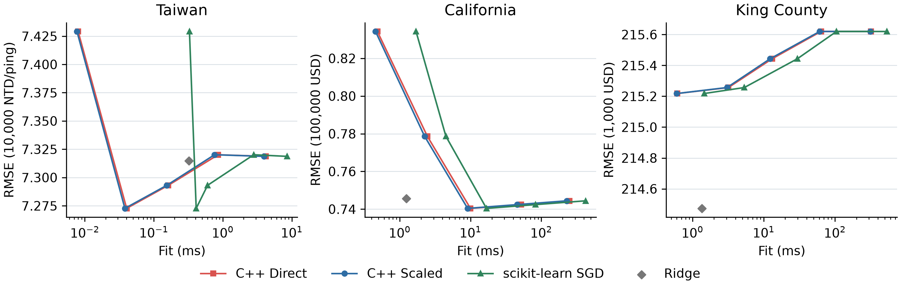

# sgd-weight-splitting-cpp

**Verifying the Weight-Splitting Technique for L2-Regularized SGD on Sparse Data with an Independent C++17 Implementation**

This project implements direct and scaled-weight SGD for L2-regularized regression in C++17 and compares them with scikit-learn's `SGDRegressor`. The revised benchmarks pair measured fit times with prediction times and regression errors on the same held-out data for each model and configuration.

[English paper](docs/26125082.pdf) · [LaTeX source](docs/paper_en.tex) · [Reproduction guide](REPRODUCE.md)

## 1. Research Questions

- **RQ1.** How does the cost per update change with the number of features, density, and sample count? Do the three SGD implementations agree on a shared synthetic test set?
- **RQ2.** Do the C++ implementations reproduce scikit-learn on three housing splits? How do fit time, prediction error, and distance to Ridge change with the epoch budget?

## 2. Key Results

- At one million features and 20 nonzeros per sample, the Scaled C++ loop is about **3,198× faster** than the Direct loop. The full-fit medians are 4.367 ms and 6,598.362 ms, respectively. Both models have test RMSE 1.01252.
- At 100% synthetic feature density, the Direct/Scaled loop-time ratio is 1.12×. Across all 12 synthetic configurations, the maximum relative weight difference is 5.11e-14.
- On housing data, both C++ implementations pass the numerical equivalence thresholds at all 15 dataset and epoch combinations. For California, Scaled reaches the lowest test RMSE of the tested SGD checkpoints at 20 epochs (0.7404, 9.096 ms). At 500 epochs, it fits in 228.331 ms with RMSE 0.7444 and is closer to the Ridge solution.

[Benchmark checks](results/SUMMARY.md) · [Synthetic results](results/tables/rq1_paired.csv) · [Taiwan](results/tables/rq2_taiwan.csv) · [California](results/tables/rq2_california.csv) · [King County](results/tables/rq2_kingcounty.csv)



## 3. Repository Structure

```text
├── Makefile                   # Top-level build and orchestration targets
├── make.cmd                   # Windows wrapper forwarding to mingw32-make
├── requirements.txt           # Pinned Python package dependencies
├── cpp/
│   ├── include/
│   │   ├── csr.hpp            # Binary CSR parser and data structures
│   │   ├── json_writer.hpp    # Strict JSON formatting for benchmark metadata
│   │   ├── schedule.hpp       # Learning rate schedules (invscaling, optimal)
│   │   ├── sgd_direct.hpp     # O(n) direct vector shrinkage SGD
│   │   ├── sgd_scaled.hpp     # O(k) scaled weight SGD (w = s * v)
│   │   └── timer.hpp          # High-resolution std::chrono timing harnesses
│   └── src/
│       └── main.cpp           # CLI binary entry point
├── python/sgdrepro/
│   ├── bench_sklearn.py       # scikit-learn SGDRegressor timing harness
│   ├── binio.py               # SGDCSR01 binary matrix I/O
│   ├── compare_reference.py   # Automated verification against reference archive
│   ├── envinfo.py             # Environment discovery and logging
│   ├── gen_rq1.py             # RQ1 synthetic CSR dataset generator
│   ├── make_figures.py        # Publication-ready matplotlib figure generator
│   ├── make_tables.py         # CSV, LaTeX, and Markdown table generator
│   ├── metrics.py             # RMSE, MAE, R2, and Ridge distance metrics
│   ├── prep_rq2.py            # RQ2 housing dataset downloader & preprocessor
│   ├── ridge.py               # Closed-form Ridge analytical reference
│   ├── run_cpp.py             # C++ subprocess benchmark driver
│   ├── run_rq1.py             # RQ1 benchmark runner (Grids A, B, C)
│   ├── run_rq2.py             # RQ2 benchmark runner (3 datasets x 5 epochs)
│   └── summary_gen.py         # Automated hypothesis adjudication generator
├── configs/
│   └── data_checksums.json    # SHA-256 integrity hashes for all datasets
├── data/                      # Processed binary CSR datasets (gitignored)
├── docs/
│   ├── 26125082.pdf           # Project paper / technical report (CS161 final project)
│   ├── DATA.md                # Dataset provenance, attributes, and preprocessing
│   ├── LIMITATIONS.md         # Study scope, boundaries, and hardware constraints
│   └── sklearn_source_audit.md# Detailed Cython source code audit
├── results/
│   ├── figures/               # Generated 300 DPI PNG and PDF plots
│   ├── tables/                # Generated Markdown, CSV, and LaTeX tables
│   ├── reference/             # Archived baseline benchmarks for `make verify`
│   ├── env.json               # Environment hardware and software profile
│   └── SUMMARY.md             # Empirical hypothesis adjudication summary
└── tests/                     # 39 unit and step-ladder numerical tests
```

---

## 4. Quick Start (5 Minutes)

To verify the environment, build the C++ binary, and run the smoke test:

```bash
# 1. Setup environment and inspect hardware
make setup

# 2. Build C++ binary with MinGW GCC
make build

# 3. Run equivalence unit tests
make test

# 4. Run end-to-end smoke test on minimal grids (writes to results_smoke/)
make smoke
```

The smoke run writes its benchmark records to `results_smoke/`. The full run also generates the result tables and figures.

For the full reproduction of all experiments, see [REPRODUCE.md](REPRODUCE.md).

---

## 5. Data

### Synthetic sparse data (RQ1)

In real data the number of features, the density, and the number of samples are usually tied together. Synthetic data lets each factor vary alone, using three grids:

- **Grid A:** dimension $n \in [10^3, 10^6]$, $k = 20$, $m = 10^4$.
- **Grid B:** density from 0.1% to 100%, $n = 5{,}000$, $m = 5{,}000$.
- **Grid C:** samples $m \in [10^3, 10^6]$, $n = 10^4$, $k = 20$.

Each sample has exactly $k$ distinct column indices chosen uniformly at random. Values are drawn from $\mathcal{N}(0,1)$ and normalized to $\|x_i\|_2 = 1$ so that the gradient does not blow up for large $n$. Labels come from a true weight vector drawn from a standard normal distribution plus Gaussian noise with standard deviation 0.1. The seed is `[42, n, k, m]`, and every file has a SHA-256 hash in `configs/data_checksums.json`.

### Real data (RQ2)

Three public house-price datasets with 6 to 17 features and 414 to 21,613 rows. The four models use the same 80/20 split for each dataset.

| Dataset | Source | Features | Notes |
|---|---|---|---|
| **Taiwan** | Yeh and Hsu [5], Xindian district | 6 | Drops column `No` |
| **California** | 1990 census [6] | 8 | Target is artificially capped; about 4.7% of observations sit at the ceiling |
| **King County** | OpenML [7], sales from 5/2014 to 5/2015 | 17 | Drops `id`, `date`, `zipcode` (high-cardinality identifier); prices are strongly right-skewed |

### Preprocessing

- 80/20 split with `random_state=42`, `shuffle=True`; row indices are saved so that C++, scikit-learn, and Ridge share one partition.
- Z-score standardization of both $X$ and $y$, with mean and standard deviation (`ddof=0`) computed on the training set only.
- Predictions are transformed back to original units before computing RMSE, MAE, and $R^2$.
- Data is stored in the binary format `SGDCSR01`: a 32-byte header (identifier, $m$, $n$, nnz), then `indptr` (int32), `indices` (int32), `data` (float64), and $y$ (float64). This avoids CSV parsing and preserves every bit of float64 between Python and C++.

See [docs/DATA.md](docs/DATA.md) for full provenance.

---

## 6. Measurement Protocol and Environment

The revised run used Windows 11, MinGW GCC 14.2.0 (`-std=c++17 -O2 -static`), Python 3.12.14, NumPy 2.5.4, SciPy 1.18.1, and scikit-learn 1.9.1. The numerical libraries ran with one thread. [Recorded environment](results/env.json).

- Each model and epoch budget uses one warmup and seven timed measurements. The tables report the median and IQR.
- The full fit timer covers the C++ training call or scikit-learn's `fit`. C++ also records the time inside its SGD loop for the RQ1 per-update comparison.
- The first timed fit supplies the coefficients for test prediction. The same Python prediction function runs on each model's coefficients, and RMSE, MAE, and R² come from its first timed test prediction.
- Data loading, process startup, and metric computation are outside the measured fit and prediction calls.

---

## 7. Scope of Equivalence with scikit-learn

### What is matched

The C++ code follows the Cython code of scikit-learn 1.9.1 on these points:

1. The $(s, v)$ representation, as in `wscale` / `w`.
2. The reset (renormalization) threshold of $10^{-9}$.
3. The order of operations: dot product, gradient clipping, shrinkage, then the add step (only when the update $u \neq 0$).
4. Gradient clipping at $\pm 10^{12}$.
5. An unpenalized intercept that is not shrunk and uses `intercept_decay`.
6. The `invscaling` schedule $\eta_t = \eta_0 / t^p$ (where exponent $p =$ `power_t`) with $t$ starting at 1 and continuing across epochs.
7. Sequential traversal (`shuffle=False`) and no early stopping (`tol=None`).

### What is not guaranteed

1. **Wall-clock times.** Absolute times depend on Python/Cython call overhead, compiler flags, and the CPU.
2. **Bit-for-bit identity across compilers and architectures.** The Scaled coefficients matched scikit-learn in this run under the recorded compiler and library settings. Other floating-point contraction modes (for example `-ffp-contract=fast` vs `off`) or other architectures (x86-64 AVX2 vs ARM NEON) may introduce roundoff differences around $10^{-16}$.

---

## 8. Limitations

1. **Measurement environment.** The revised timings come from one Windows machine. CPU scheduling, cache behavior, and compiler settings can change the measured ratios.
2. **Data.** RQ1 data has uniformly random sparsity, while real data such as TF-IDF and Bag-of-Words often follows a Zipf distribution [9], which can change cache access patterns even though the cost per step stays $O(k)$. RQ2 covers three low-dimensional housing datasets and one split per dataset.
3. **Algorithm scope.** Only sequential single-threaded SGD is covered (no Hogwild! [8]), without early stopping, using the `invscaling` schedule on standardized data. The `optimal` schedule and the forced-reset configuration are used only in unit tests. The foundational papers [1, 2] mainly target margin-based classification (hinge loss); this study covers squared loss only.

**Future work.** Measure on real sparse data with Zipf-like feature frequencies (for example MovieLens or text classification), try more architectures and compilers, and extend to other loss functions.

---

## 9. References

1. L. Bottou, "Stochastic gradient descent tricks," in *Neural Networks: Tricks of the Trade*, 2nd ed., Springer LNCS 7700, pp. 421-436, 2012.
2. S. Shalev-Shwartz, Y. Singer, N. Srebro and A. Cotter, "Pegasos: Primal estimated sub-gradient solver for SVM," *Mathematical Programming*, vol. 127, no. 1, pp. 3-30, 2011.
3. F. Pedregosa et al., "Scikit-learn: Machine learning in Python," *Journal of Machine Learning Research*, vol. 12, pp. 2825-2830, 2011. SGD solver: `sklearn/linear_model/_sgd_fast.pyx`.
4. A. E. Hoerl and R. W. Kennard, "Ridge regression: Biased estimation for nonorthogonal problems," *Technometrics*, vol. 12, no. 1, pp. 55-67, 1970.
5. I-C. Yeh and T.-K. Hsu, "Building real estate valuation models with comparative approach through case-based reasoning," *Applied Soft Computing*, vol. 65, pp. 260-271, 2018.
6. R. K. Pace and R. Barry, "Sparse spatial autoregressions," *Statistics & Probability Letters*, vol. 33, no. 3, pp. 291-297, 1997.
7. J. Vanschoren, J. N. van Rijn, B. Bischl and L. Torgo, "OpenML: Networked science in machine learning," *ACM SIGKDD Explorations Newsletter*, vol. 15, no. 2, pp. 49-60, 2014.
8. F. Niu, B. Recht, C. Re and S. J. Wright, "Hogwild!: A lock-free approach to parallelizing stochastic gradient descent," in *Advances in Neural Information Processing Systems 24*, pp. 693-701, 2011.
9. G. K. Zipf, *Human Behavior and the Principle of Least Effort*. Cambridge, MA: Addison-Wesley, 1949.

The numbering matches the accompanying paper.

---

## 10. AI Assistance Declaration

The text of the accompanying paper was written with the help of Claude Sonnet 5.5 (free web version, Anthropic), used for rewriting and editing the text and for drafting the reference list. Claude / Gemini AI Assistant (via Antigravity IDE) was employed as an automated pair-programming assistant for scaffold generation, script orchestration, Cython source auditing, and Markdown formatting. The author reviewed all outputs, audited the mathematical and algorithmic implementations, and takes full responsibility for all content in the paper and repository.
