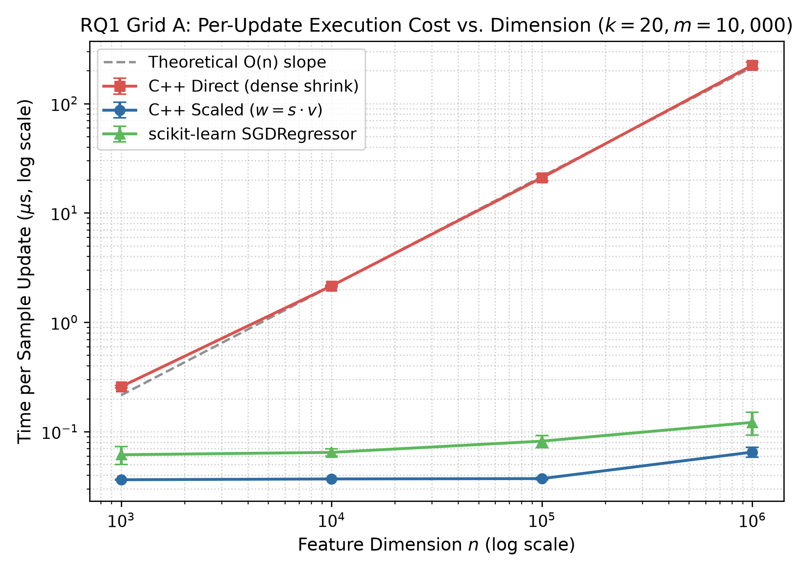
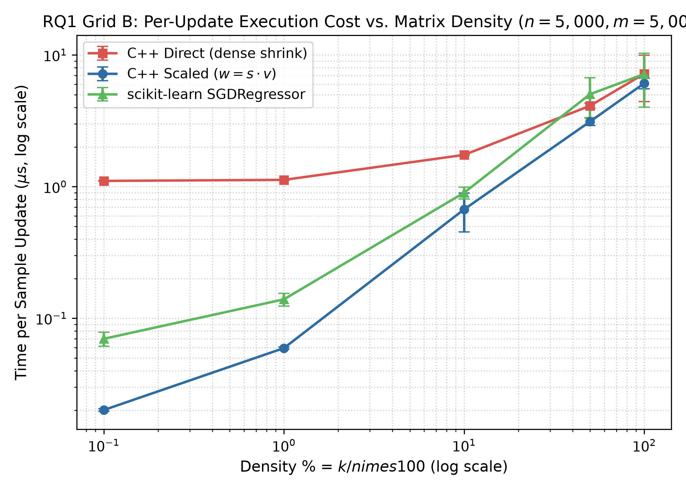
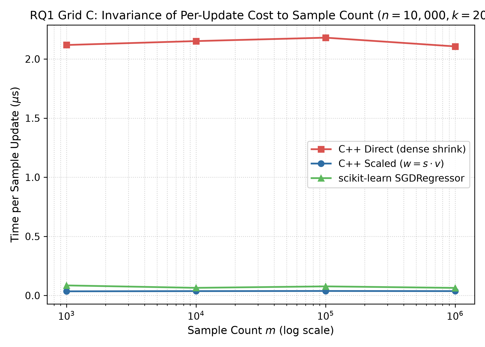
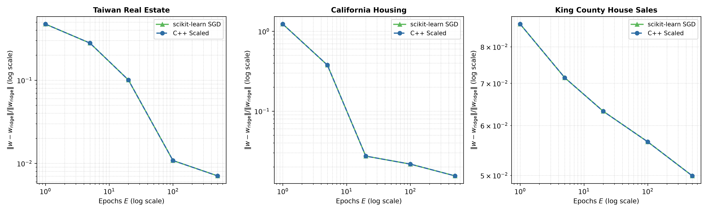
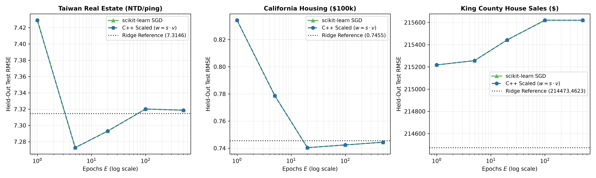

# sgd-weight-splitting-cpp

**Verifying the Weight-Splitting Technique for L2-Regularized SGD on Sparse Data with an Independent C++17 Implementation**

> **Summary.** L2 regularization forces every SGD step to shrink the whole weight vector, so the cost per step grows with the number of features $n$ even when each sample has only $k \ll n$ non-zeros. Writing the weights as $w = s \cdot v$ (a scalar and a vector) removes this cost. This repository implements both forms in pure C++17 and benchmarks them against scikit-learn's `SGDRegressor`. At $n = 10^6$, $k = 20$ the split form is **3446x faster** per step than the direct form, and on three housing datasets its weights match scikit-learn **bit-for-bit** in the measured environment. The full project paper is available at [docs/26125082.pdf](docs/26125082.pdf).

---

## 1. Overview and Research Questions

The weight-splitting technique is not new: it was described by Shalev-Shwartz et al. (Pegasos) [2] and Bottou [1], and scikit-learn [3] uses it inside `SGDRegressor`. This repository verifies it for L2-regularized least squares by implementing two variants in C++17 (direct update and weight-splitting update) and comparing them with scikit-learn 1.9.1. It answers two questions:

- **RQ1 (per-step cost).** How does the cost per step of the two forms change with the number of features, the density, and the number of samples?
- **RQ2 (reproducibility).** Can the independent C++17 implementation reproduce scikit-learn's `SGDRegressor` on real data?

Seven hypotheses with quantitative acceptance criteria were specified in advance (H1-a to H1-e for RQ1, H2-a and H2-b for RQ2). All seven are supported under the measurement conditions described in Section 6.

---

## 2. Key Results

All metrics below come from the raw JSON outputs in `results/raw/` (Git commit `87b234c`, tag `v1.0-submission`, AMD Ryzen 9 8940HX, Windows 11).

### Hypothesis Adjudication

| ID | Pre-specified Hypothesis | Acceptance Criterion | Observed Result | Status |
|---|---|---|---|---|
| **H1-a** | Split update ($w = s \cdot v$) is much faster on sparse data | $t_\text{dir}/t_\text{sc} \ge 2$ at $n \ge 10^4$ and monotonic | $n=10^4$: 58.27x; $n=10^5$: 564.24x; $n=10^6$: 3446.04x | **SUPPORTED** |
| **H1-b** | Direct cost grows as $O(n)$, split cost is nearly flat | Direct slope $\in [0.7, 1.1]$; split slope $\le 0.35$ | Direct: 1.009; split: 0.123 | **SUPPORTED** |
| **H1-c** | On dense data (100%) the two forms have the same order of cost | $0.5 \le t_\text{dir}/t_\text{sc} \le 3.0$ at 100% density | 1.18x | **SUPPORTED** |
| **H1-d** | Split cost per step does not depend on the number of samples $m$ | Grid C: $\max(t_\text{sc}) / \min(t_\text{sc}) \le 1.3$ | 1.08 | **SUPPORTED** |
| **H1-e** | C++ direct and C++ split give the same solution | $\lVert w_\text{sv} - w_\text{dir} \rVert / \lVert w \rVert < 10^{-10}$ | Relative discrepancy $\le 7.44 \times 10^{-15}$ (float64 rounding level) | **SUPPORTED** |
| **H2-a** | C++ split is numerically equivalent to scikit-learn | $\lvert \Delta \text{RMSE} \rvert / \text{RMSE} < 10^{-6}$ and $\lVert \Delta w \rVert / \lVert w \rVert < 10^{-10}$ | Exactly 0 on all 15 pairs (bit-for-bit in this environment) | **SUPPORTED** |
| **H2-b** | C++ split and scikit-learn follow the same trajectory to the Ridge solution | $\lvert d_\text{cpp} - d_\text{sk} \rvert / d_\text{sk} < 10^{-6}$ at every epoch | Exactly 0 at every epoch | **SUPPORTED** |

### RQ1: Cost per Step

Cost is the median time per update in microseconds; speedup is $t_\text{direct} / t_\text{scaled}$.

#### Grid A: dimension ($n \in [10^3, 10^6]$, $k = 20$, $m = 10^4$)



- Direct cost grows linearly with $n$ (log-log slope 1.009, $R^2 > 0.9999$) and reaches 223.89 $\mu$s per update at $n = 10^6$.
- Split cost is almost flat (0.0363 to 0.0650 $\mu$s, log-log slope 0.123), which gives a **3446x** speedup at $n = 10^6$. Training 3 epochs on $10^4$ samples drops from 6.72 s to 1.95 ms.
- The small rise at $n = 10^6$ is likely because the 8 MB vector $v$ no longer fits in the L2 cache. This has not been confirmed with hardware counters.

#### Grid B: density ($0.1\%$ to $100\%$, $n = 5{,}000$, $m = 5{,}000$)



- The advantage shrinks as density grows: 54.99x at 0.1%, 18.95x at 1%, 2.59x at 10%, and 1.18x at 100%.
- At 100% density both forms are $O(n)$. The split form is not slower, but 1.18x is small compared with the measurement spread (error bars in Figure 2), so the safe conclusion is that no significant slowdown was observed.

#### Grid C: number of samples ($m \in [10^3, 10^6]$, $n = 10^4$, $k = 20$)



- Split cost stays between 0.0352 and 0.0380 $\mu$s (max/min ratio 1.08) and the speedup stays at 57x to 60x. The cost per step does not depend on the size of the training set.

#### Comparison with scikit-learn

C++ split is about 1.7x to 2.2x faster than `SGDRegressor` on Grid A and 1.2x to 3.5x on Grid B. `SGDRegressor` is timed through the Python interface, so the measurement conditions are not fully identical; treat this as a reference comparison.

### RQ2: Equivalence and Convergence on Housing Data

**Equivalence.** On all 15 pairs (3 datasets x 5 epoch budgets $E \in \{1, 5, 20, 100, 500\}$), the relative weight error, relative RMSE error, and the MAE and $R^2$ deviations are exactly 0, i.e. bit-for-bit identical in this environment. At every epoch the distance to the Ridge solution is also identical, so both implementations follow the same trajectory.

**Convergence.** The distance to the closed-form Ridge solution, $d_\text{ridge} = \lVert w - w_\text{ridge} \rVert / \lVert w_\text{ridge} \rVert$, decreases monotonically with $E$ on all three datasets. With the `invscaling` schedule SGD has not reached the Ridge solution after 500 epochs.

| Dataset | Features | Test RMSE at $E=500$ (C++ = scikit-learn) | Ridge test RMSE | $d_\text{ridge}$ at $E=500$ | Time at $E=500$ (C++ split vs scikit-learn) |
|---|---|---|---|---|---|
| **Taiwan** | 6 | 7.3187 | 7.3146 | 0.71% | 3.75 ms vs 8.06 ms |
| **California** | 8 | 0.7444 | 0.7455 | 1.55% | 225.9 ms vs 395.8 ms |
| **King County** | 17 | 215,620 USD | 214,473 USD | 4.99% | 305.8 ms vs 461.2 ms |





- On Taiwan and California the test RMSE at $E=500$ is very close to Ridge's; on King County it is about 0.5% higher.
- C++ split is about 1.5x to 2.2x faster than `SGDRegressor` at $E=500$. At small $E$ the ratio is much larger (Taiwan, $E=1$: 0.93 ms vs 0.01 ms) because the total time of `SGDRegressor` includes a fixed cost that does not depend on $E$. The $E=500$ ratio is closer to the real training cost.

---

## 3. Repository Structure

```text
├── Makefile                   # Top-level build and orchestration targets
├── make.cmd                   # Windows wrapper forwarding to mingw32-make
├── requirements.txt           # Pinned Python package dependencies
├── cpp/
│   ├── include/
│   │   ├── csr.hpp            # Binary CSR parser and data structures
│   │   ├── json_writer.hpp    # Strict JSON formatting for benchmark metadata
│   │   ├── schedule.hpp       # Learning rate schedules (invscaling, optimal)
│   │   ├── sgd_direct.hpp     # O(n) direct vector shrinkage SGD
│   │   ├── sgd_scaled.hpp     # O(k) scaled weight SGD (w = s * v)
│   │   └── timer.hpp          # High-resolution std::chrono timing harnesses
│   └── src/
│       └── main.cpp           # CLI binary entry point
├── python/sgdrepro/
│   ├── bench_sklearn.py       # scikit-learn SGDRegressor timing harness
│   ├── binio.py               # SGDCSR01 binary matrix I/O
│   ├── compare_reference.py   # Automated verification against reference archive
│   ├── envinfo.py             # Environment discovery and logging
│   ├── gen_rq1.py             # RQ1 synthetic CSR dataset generator
│   ├── make_figures.py        # Publication-ready matplotlib figure generator
│   ├── make_tables.py         # CSV, LaTeX, and Markdown table generator
│   ├── metrics.py             # RMSE, MAE, R2, and Ridge distance metrics
│   ├── prep_rq2.py            # RQ2 housing dataset downloader & preprocessor
│   ├── ridge.py               # Closed-form Ridge analytical reference
│   ├── run_cpp.py             # C++ subprocess benchmark driver
│   ├── run_rq1.py             # RQ1 benchmark runner (Grids A, B, C)
│   ├── run_rq2.py             # RQ2 benchmark runner (3 datasets x 5 epochs)
│   └── summary_gen.py         # Automated hypothesis adjudication generator
├── configs/
│   └── data_checksums.json    # SHA-256 integrity hashes for all datasets
├── data/                      # Processed binary CSR datasets (gitignored)
├── docs/
│   ├── 26125082.pdf           # Project paper / technical report (CS161 final project)
│   ├── DATA.md                # Dataset provenance, attributes, and preprocessing
│   ├── LIMITATIONS.md         # Study scope, boundaries, and hardware constraints
│   └── sklearn_source_audit.md# Detailed Cython source code audit
├── results/
│   ├── figures/               # Generated 300 DPI PNG and PDF plots
│   ├── tables/                # Generated Markdown, CSV, and LaTeX tables
│   ├── reference/             # Archived baseline benchmarks for `make verify`
│   ├── env.json               # Environment hardware and software profile
│   └── SUMMARY.md             # Empirical hypothesis adjudication summary
└── tests/                     # 38 unit and step-ladder numerical tests
```

---

## 4. Quick Start (5 Minutes)

To verify the environment, build the C++ binary, and run the smoke test:

```bash
# 1. Setup environment and inspect hardware
make setup

# 2. Build C++ binary with MinGW GCC
make build

# 3. Run equivalence unit tests
make test

# 4. Run end-to-end smoke test on minimal grids (writes to results_smoke/)
make smoke
```

**Expected outcome.** All 38 pytest tests pass with zero warnings, `build/sgd_cpp.exe` compiles with zero warnings, and the smoke pipeline finishes in under 3 minutes and writes verification tables to `results_smoke/`.

For the full reproduction of all experiments, see [REPRODUCE.md](REPRODUCE.md).

---

## 5. Data

### Synthetic sparse data (RQ1)

In real data the number of features, the density, and the number of samples are usually tied together. Synthetic data lets each factor vary alone, using three grids:

- **Grid A:** dimension $n \in [10^3, 10^6]$, $k = 20$, $m = 10^4$.
- **Grid B:** density from 0.1% to 100%, $n = 5{,}000$, $m = 5{,}000$.
- **Grid C:** samples $m \in [10^3, 10^6]$, $n = 10^4$, $k = 20$.

Each sample has exactly $k$ distinct column indices chosen uniformly at random. Values are drawn from $\mathcal{N}(0,1)$ and normalized to $\|x_i\|_2 = 1$ so that the gradient does not blow up for large $n$. Labels come from a true weight vector drawn from a standard normal distribution plus Gaussian noise with standard deviation 0.1. The seed is `[42, n, k, m]`, and every file has a SHA-256 hash in `configs/data_checksums.json`.

### Real data (RQ2)

Three public house-price datasets, from small ($m \approx 400$) to medium ($m \approx 20{,}000$). All three are fully dense, so RQ2 tests equivalence and convergence only, not speedup.

| Dataset | Source | Features | Notes |
|---|---|---|---|
| **Taiwan** | Yeh and Hsu [5], Xindian district | 6 | Drops column `No` |
| **California** | 1990 census [6] | 8 | Target is artificially capped; about 4.7% of observations sit at the ceiling |
| **King County** | OpenML [7], sales from 5/2014 to 5/2015 | 17 | Drops `id`, `date`, `zipcode` (high-cardinality identifier); prices are strongly right-skewed |

### Preprocessing

- 80/20 split with `random_state=42`, `shuffle=True`; row indices are saved so that C++, scikit-learn, and Ridge share one partition.
- Z-score standardization of both $X$ and $y$, with mean and standard deviation (`ddof=0`) computed on the training set only.
- Predictions are transformed back to original units before computing RMSE, MAE, and $R^2$.
- Data is stored in the binary format `SGDCSR01`: a 32-byte header (identifier, $m$, $n$, nnz), then `indptr` (int32), `indices` (int32), `data` (float64), and $y$ (float64). This avoids CSV parsing and preserves every bit of float64 between Python and C++.

See [docs/DATA.md](docs/DATA.md) for full provenance.

---

## 6. Measurement Protocol and Environment

| Component | Version |
|---|---|
| CPU / RAM / OS | AMD Ryzen 9 8940HX, 16 GB DDR5, Windows 11 |
| C++ compiler | MinGW-W64 GCC 14.2.0, `-std=c++17 -O2` |
| Python / NumPy / SciPy | 3.12.9 / 2.5.4 / 1.18.1 |
| scikit-learn | 1.9.1 |

- Single-threaded: `OMP_NUM_THREADS`, `OPENBLAS_NUM_THREADS`, and `MKL_NUM_THREADS` are all set to 1.
- Only the algorithm loop is timed (`std::chrono::steady_clock`). File reading and the reconstruction of $w = s \cdot v$ are outside the timed region.
- Each measurement is 1 warm-up run plus 7 repeats; the median and IQR are reported.
- The final $w$ is hashed with SHA-256 so that the compiler cannot eliminate the loop as dead code.
- Windows 11 has no standard `taskset`, so processes cannot be pinned to a core. Process priority is set to high instead; the spread remains noticeable at high density (Figure 2).

---

## 7. Scope of Equivalence with scikit-learn

### What is matched

The C++ code follows the Cython code of scikit-learn 1.9.1 on these points:

1. The $(s, v)$ representation, as in `wscale` / `w`.
2. The reset (renormalization) threshold of $10^{-9}$.
3. The order of operations: dot product, gradient clipping, shrinkage, then the add step (only when the update $u \neq 0$).
4. Gradient clipping at $\pm 10^{12}$.
5. An unpenalized intercept that is not shrunk and uses `intercept_decay`.
6. The `invscaling` schedule $\eta_t = \eta_0 / t^p$ (where exponent $p =$ `power_t`) with $t$ starting at 1 and continuing across epochs.
7. Sequential traversal (`shuffle=False`) and no early stopping (`tol=None`).

### What is not guaranteed

1. **Wall-clock times.** Absolute times depend on Python/Cython call overhead, compiler flags, and the CPU.
2. **Bit-for-bit identity across compilers and architectures.** The result "bit-for-bit" holds for this environment (same compiler, optimization flags, and library versions). Other floating-point contraction modes (for example `-ffp-contract=fast` vs `off`) or other architectures (x86-64 AVX2 vs ARM NEON) may introduce roundoff differences around $10^{-16}$.

---

## 8. Limitations

1. **Measurement environment.** All timings come from one machine (Ryzen 9 8940HX), one compiler (GCC 14.2.0, `-O2`), and one operating system (Windows 11). Absolute times will differ elsewhere, and the small rise at $n = 10^6$ depends on cache size. The relative speedup and the log-log slopes are properties of the algorithm and likely transfer, but this has not been verified on other architectures.
2. **Data.** RQ1 data has uniformly random sparsity, while real data such as TF-IDF and Bag-of-Words often follows a Zipf distribution [9], which can change cache access patterns even though the cost per step stays $O(k)$. RQ2 data is small and dense ($n \in \{6, 8, 17\}$), so it tests equivalence and convergence only.
3. **Algorithm scope.** Only sequential single-threaded SGD is covered (no Hogwild! [8]), without early stopping, using the `invscaling` schedule on standardized data. The `optimal` schedule and the forced-reset configuration are used only in unit tests. The foundational papers [1, 2] mainly target margin-based classification (hinge loss); this study covers squared loss only.

**Future work.** Measure on real sparse data with Zipf-like feature frequencies (for example MovieLens or text classification), try more architectures and compilers, and extend to other loss functions.

---

## 9. References

1. L. Bottou, "Stochastic gradient descent tricks," in *Neural Networks: Tricks of the Trade*, 2nd ed., Springer LNCS 7700, pp. 421-436, 2012.
2. S. Shalev-Shwartz, Y. Singer, N. Srebro and A. Cotter, "Pegasos: Primal estimated sub-gradient solver for SVM," *Mathematical Programming*, vol. 127, no. 1, pp. 3-30, 2011.
3. F. Pedregosa et al., "Scikit-learn: Machine learning in Python," *Journal of Machine Learning Research*, vol. 12, pp. 2825-2830, 2011. SGD solver: `sklearn/linear_model/_sgd_fast.pyx`.
4. A. E. Hoerl and R. W. Kennard, "Ridge regression: Biased estimation for nonorthogonal problems," *Technometrics*, vol. 12, no. 1, pp. 55-67, 1970.
5. I-C. Yeh and T.-K. Hsu, "Building real estate valuation models with comparative approach through case-based reasoning," *Applied Soft Computing*, vol. 65, pp. 260-271, 2018.
6. R. K. Pace and R. Barry, "Sparse spatial autoregressions," *Statistics & Probability Letters*, vol. 33, no. 3, pp. 291-297, 1997.
7. J. Vanschoren, J. N. van Rijn, B. Bischl and L. Torgo, "OpenML: Networked science in machine learning," *ACM SIGKDD Explorations Newsletter*, vol. 15, no. 2, pp. 49-60, 2014.
8. F. Niu, B. Recht, C. Re and S. J. Wright, "Hogwild!: A lock-free approach to parallelizing stochastic gradient descent," in *Advances in Neural Information Processing Systems 24*, pp. 693-701, 2011.
9. G. K. Zipf, *Human Behavior and the Principle of Least Effort*. Cambridge, MA: Addison-Wesley, 1949.

The numbering matches the accompanying paper.

---

## 10. AI Assistance Declaration

The text of the accompanying paper was written with the help of Claude Sonnet 5.5 (free web version, Anthropic), used for rewriting and editing the text and for drafting the reference list. Claude / Gemini AI Assistant (via Antigravity IDE) was employed as an automated pair-programming assistant for scaffold generation, script orchestration, Cython source auditing, and Markdown formatting. The author reviewed all outputs, audited the mathematical and algorithmic implementations, and takes full responsibility for all content in the paper and repository.
